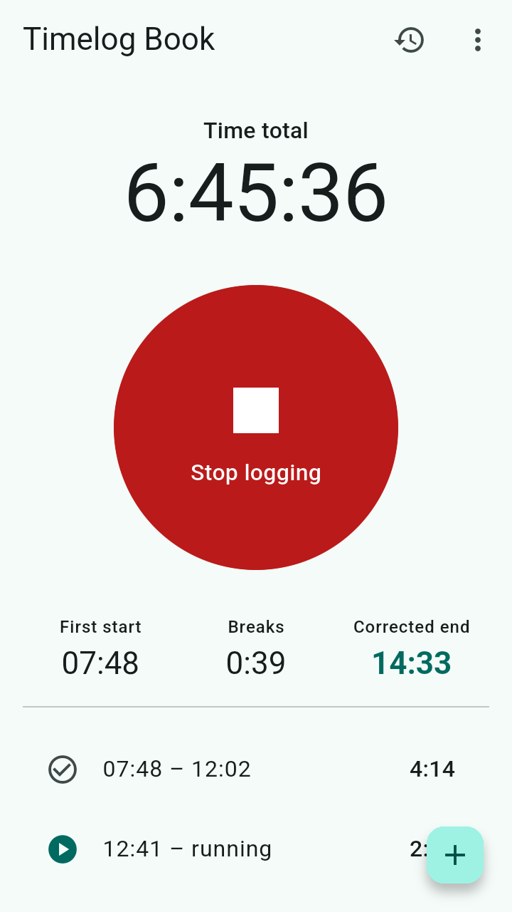
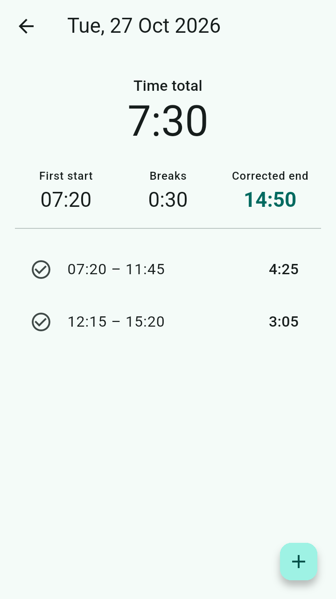
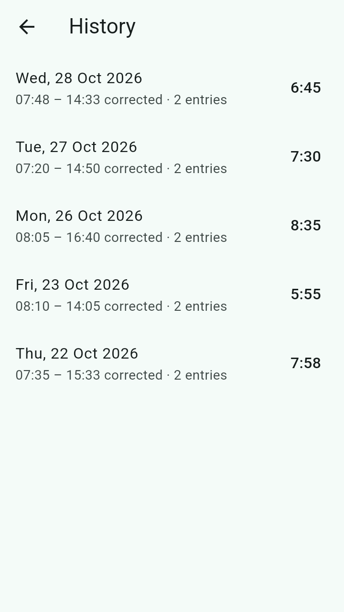
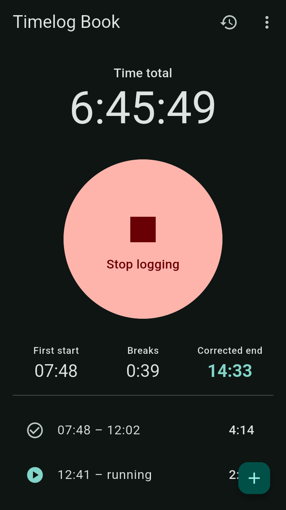

# Timelog Book

A very simple time logbook for Android (iOS planned). Free software, no ads, no tracking –
your data never leaves your device. Built with Flutter.

<p>
  
  
  
  
</p>

## Install

Two ways, both free:

1. **Download from GitHub** — take the `arm64-v8a` APK from the
   [latest release](https://github.com/LeoStumpf/TimelogBook/releases/latest) (it fits nearly
   every phone; `armeabi-v7a` is for older 32-bit ones), open it and allow the install. To get
   updates automatically, add this repository to [Obtainium](https://obtainium.imranr.dev/).
2. **Install through Google Play as a tester** — *coming soon.* A closed test on Google Play is
   being set up; this section will link to it once it is open.

The two are signed differently, so Android will not update one with the other: to switch,
uninstall one and install the other. The app has no import yet, so export your entries first
if you want to keep a record of them (⋮ → Export CSV → Everything).

> **Transparency:** Timelog Book was "vibe-coded" collaboratively with Claude (Anthropic's AI
> assistant), which wrote much of the code under human direction.

## Features

- One big button: **Start logging** / **Stop logging**
- While logging, a persistent notification with a **Stop logging** button, so you can
  pause without opening the app. After stopping, a dismissible notification shows the
  day's total and has a **Start logging** button.
- **Time total** for the day, all entries with start/stop, the sum of **breaks** and the
  **corrected end** (first start + total, i.e. the end time without breaks).
  Example: 07:20 – 15:20 with a one hour break → corrected end 14:20.
- Edit, add and delete entries, browse past days, export as CSV.

An entry that runs past midnight counts for the day it started.

## Develop

Requires the [Flutter SDK](https://docs.flutter.dev/get-started/install) (stable, 3.44).

```sh
flutter pub get
flutter test
flutter run                       # on a connected device / emulator
flutter build apk --split-per-abi # release APKs in build/app/outputs/flutter-apk/
flutter build appbundle           # the bundle (AAB) for Google Play
```

**Release signing:** release builds are signed with the upload key named in
`android/key.properties` (gitignored, like every `*.jks`):

```properties
storePassword=<store password>
keyPassword=<key password>
keyAlias=upload
storeFile=/home/<you>/timelogbook-upload-keystore.jks
```

Without that file the release build falls back to the debug key — fine for testing, never
for distribution.

**CI** (`.github/workflows/ci.yml`) checks formatting, runs `flutter analyze` and the tests,
and builds the signed split APKs and the AAB on every push to `main` (kept as a workflow
artifact for 30 days). The key comes from three repository secrets —
`ANDROID_KEYSTORE_BASE64`, `ANDROID_KEYSTORE_PASSWORD`, `ANDROID_KEY_PASSWORD` — which forks
never see.

### Releasing

1. Raise `version:` in `pubspec.yaml` (`<name>+<versionCode>`; the code only ever goes up)
   and `kAppVersion` in `lib/app_info.dart` (a test keeps the two equal).
2. Write `fastlane/metadata/android/en-US/changelogs/<versionCode>.txt` (at most 500
   characters — it is also Play's "What's new").
3. Commit and push, then `git tag v<name> && git push origin v<name>`.

CI checks that the tag matches the version and publishes a GitHub release with
`TimelogBook-<name>-<abi>.apk`. For Google Play, take the AAB from that run's artifact and
upload it in Play Console. The store texts live in `fastlane/metadata/android/en-US/`.

## Notes on Android

The "logging" notification belongs to a foreground service (type `specialUse`), which is
what keeps it in place. The service does no work; the notification's chronometer is
counted by the system. On Android 14+ a foreground service notification can be swiped
away; the app then shows it again immediately.

## Privacy

No account, no analytics, no crash reporting, no advertising — and no internet permission at
all. Your entries live in a database in the app's private storage and leave the device only
when you export them as CSV yourself. Full detail in [`PRIVACY.md`](PRIVACY.md).

## License

Copyright (C) 2026 Leo Stumpf

This program is free software: you can redistribute it and/or modify it under the terms
of the GNU Affero General Public License as published by the Free Software Foundation,
either version 3 of the License, or (at your option) any later version. See
[LICENSE](LICENSE). Third-party components: [`THIRD_PARTY_NOTICES.md`](THIRD_PARTY_NOTICES.md).
